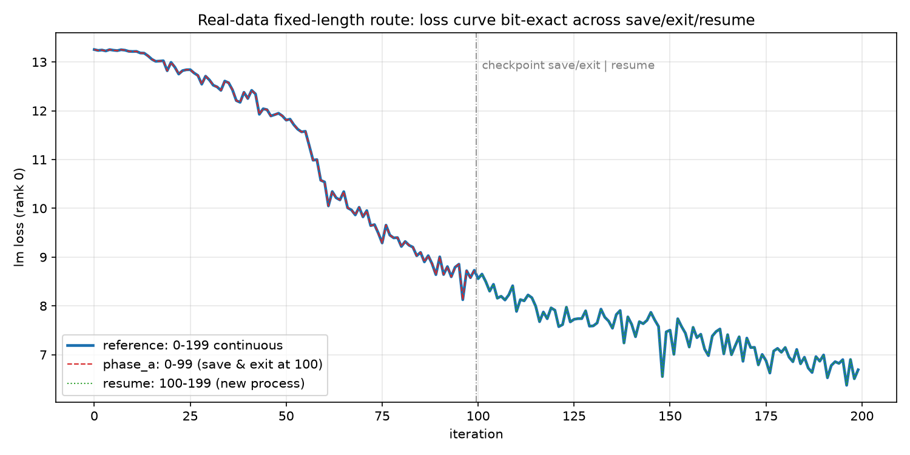
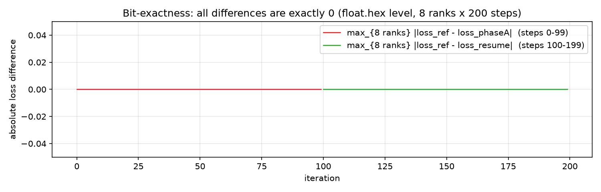
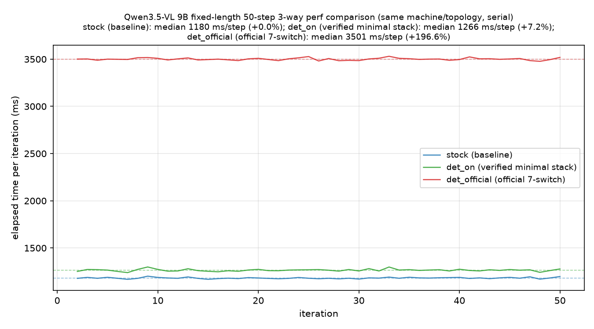
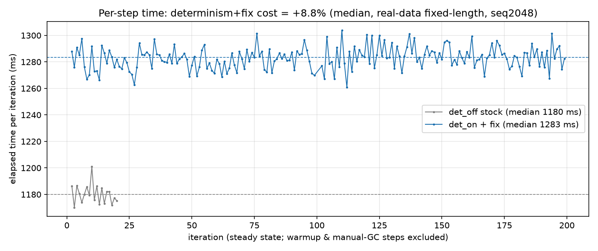
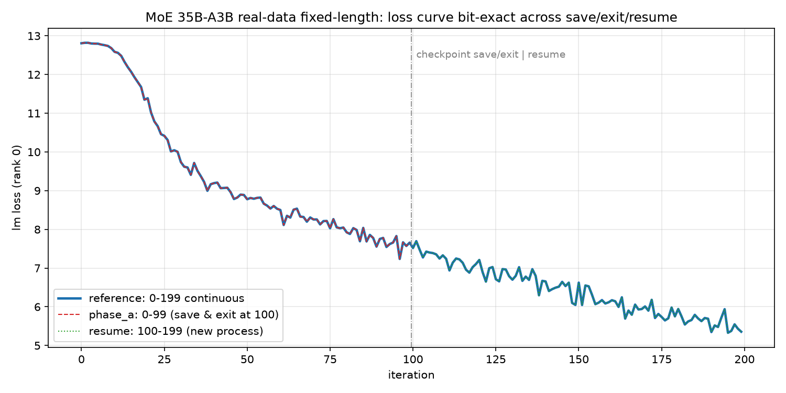

# Qwen3.5-VL @ PPU 定长训练确定性：开关原理与 Dense/MoE 实证

> **基于 Megatron-Bridge 官方 qwen_vl SFT recipe 集**：[recipes/qwen_vl/qwen35_vl.py @ ece6618](https://github.com/NVIDIA-NeMo/Megatron-Bridge/blob/ece6618/src/megatron/bridge/recipes/qwen_vl/qwen35_vl.py)（dense 9B 用 `qwen35_vl_9b_sft_config`，MoE 35B-A3B 用 `qwen35_vl_35b_a3b_sft_config`）。软件基线：Megatron-Bridge [ece6618](https://github.com/NVIDIA-NeMo/Megatron-Bridge/tree/ece6618) + Megatron-LM core 0.20.0（vendor 钉于 c9b53d0a8；因 GDN out_norm 的 TP 梯度漏归约，已 cherry-pick 上游 [#7613](https://github.com/NVIDIA/Megatron-LM/pull/7613)（提交 9e5fb8ae2），本地 vendor HEAD e54f8e660）。范围：PPU 8 卡单节点栈上的确定性训练配置与实证；两类模型（dense 9B / MoE 35B-A3B）、同一指定数据集、同一入口（`harness/train_qwen35_fixlen_det.py`）、同一验收编排。

---

## 1. Megatron 确定性模式需要配什么开关？为什么？

### 1.1 官方要求一览（7 项）

Megatron-LM 把"bit-exact 可复现执行"做成了一个显式模式，入口是 `deterministic_mode=True`。开启后官方要求以下 7 项同时成立：

| # | 开关 | 要求值 | 层 |
|---|---|---|---|
| 1 | `deterministic_mode` | `True` | Megatron config 总开关 |
| 2 | `cross_entropy_loss_fusion` | `False` | config |
| 3 | `tp_comm_overlap` | `False` | config |
| 4 | `NCCL_ALGO` | `Ring`（或 Collnet*/`^NVLS`） | 环境变量 |
| 5 | `NVTE_ALLOW_NONDETERMINISTIC_ALGO` | `0` | 环境变量（TE） |
| 6 | `CUBLAS_WORKSPACE_CONFIG` | `:4096:8`（或 `:16:8`） | 环境变量（cuBLAS） |
| 7 | `torch.use_deterministic_algorithms` | `True` | PyTorch 全局 |

### 1.2 代码作证

**证据一：`megatron/training/determinism.py`（官方确定性实现，节选）**

```python
# Maps each arg name to the value it must hold for bit-exact execution;
# verified by :func:`apply_determinism_to_args`.
ARG_VALUES_REQUIRED_FOR_DETERMINISM = {"cross_entropy_loss_fusion": False,
                                       "tp_comm_overlap": False}

# Env-var defaults required for bit-exact reproducibility.
DETERMINISM_ENV_VAR_DEFAULTS: dict[str, str] = {
    "NCCL_ALGO": "Ring",
    "NVTE_ALLOW_NONDETERMINISTIC_ALGO": "0",
    "CUBLAS_WORKSPACE_CONFIG": ":4096:8",
}
```

`apply_determinism_to_args` 的语义是**只验证、不翻转**（"verification-only check — it never mutates `args`"）：任何一项不符合就直接 assert 崩掉，绝不静默替你改配置——官方注释的原话是"a default that drifts to a bad value breaks the run instead of silently running non-deterministically"。

**证据二：NCCL_ALGO 的接受集与逐 token 担保分级（同文件，官方注释原文）**

```python
ACCEPTED_NCCL_ALGO_TOKENS = frozenset({"Ring", "CollnetDirect", "CollnetChain", "^NVLS"})
#   - ``Ring``          the default; bit-exact by construction, fully verified.
#   - ``CollnetDirect``, ``CollnetChain``  verified bit-exact at smaller scale with SHARP ...
#   - ``^NVLS``         ... some risk remains because determinism then depends on that fallback algo.
#
# ``Tree`` is intentionally NOT accepted: its intra-node chain reduction
# order is not user-controllable and its multi-node inter-tree topology can
# vary across runs without a pinned topology file, so we cannot vouch for it.
```

即：**Ring 是唯一被官方"按构造即 bit-exact + 完全验证"无条件担保的算法**；Tree 被显式拒绝，原因是节点内链式归约顺序不可控 + 多节点 inter-tree 拓扑跨 run 可变。

**证据三：Megatron-Bridge 侧的验证器（`megatron/bridge/training/config.py:1062`）**

```python
def _validate_and_apply_deterministic_mode(self) -> None:
    if not getattr(self.model, "deterministic_mode", False):
        return
    # Disallow cross-entropy loss fusion as it is not deterministic
    assert not getattr(self.model, "cross_entropy_loss_fusion", False), (
        "Cross Entropy Fusion is currently not deterministic.")
    all_reduce_choices = ("Tree", "Ring", "CollnetDirect", "CollnetChain", "^NVLS")
    assert os.getenv("NCCL_ALGO", -1) != -1 and os.getenv("NCCL_ALGO") in all_reduce_choices, ...
    torch.use_deterministic_algorithms(True)
```

注意 Bridge 验证器的 NCCL_ALGO 接受集**含 Tree、比 LM 原生宽松**（只做字符串匹配，不保证运行时支持）——两套验证器不一致，以 LM 原生 `determinism.py` 的严格口径为准。

**证据四：attention 后端不被确定性要求触碰（同文件注释原文）**

```python
# --use-flash-attn is intentionally NOT rejected: TE's FlashAttention is
# deterministic on supported configs and is covered by the bit-exact
# correctness suite.
```

即确定性模式**不要求**退回 local/math attention；生产 flash 后端在受支持配置上官方担保确定。

**证据五：官方把这套口径做成了可跑的 UT（`tests/unit_tests/determinism/`）**

- `bit_exact_runner.py` 的 `BitExactRunner`：同一恢复的 RNG 状态下两次 fwd+bwd，断言输出与梯度 bit-identical；参数化覆盖 TP/PP/VPP/CP/EP/FSDP 并行矩阵，`correctness/` 下分专项文件（GPT、hybrid、transformer layer、fp8/fp4 量化 recipe、SSM conv1d）。
- 包 import 即钉死全部确定性 env（`correctness/__init__.py` 调 `apply_determinism_env(os.environ)`；注释原话：cuBLAS / TE / NCCL "capture them at their respective first-use sites"，CI 另靠 shell 预 export 双保险）。
- `test_ssm_conv1d.py`：算子级专项 UT，文件头直接写明机制证据——SSM causal conv 的 channel-last backward 用 atomicAdd 跨 `micro_batch * ceil(seq_len/128)` 个 block 归约 weight gradient，模型级测试（32×2，仅 2 个 block）暴露不了回归，故构造 32/64 个竞争 block 的算子级用例，并要求 causal_conv1d ≥ 1.6.0 的 deterministic 路径。

**证据五（实测）：官方 UT 在本栈 PPU 上的实跑结果**

| 实验 | 命令与条件 | 结果 |
|---|---|---|
| transformer_layer 正跑 | `torch.distributed.run --nproc_per_node=4 ... pytest test_transformer_layer.py`：tp4/ep2/tp2-ep2 × gpt/llama 6 cell + **jitter 测试 2 项**（`cuda._sleep` 打乱 launch 时序，官方版"其他进程干扰"模拟） | **8 passed, 41.89s**，全部 bit-exact |
| gpt_model PP/VPP 系列 | 同上 `-k pp`：pp2/pp4/tp2-pp2/pp2-vpp2 × gpt/llama（覆盖 pipeline schedule + virtual pipeline 路径） | **8 passed, 24.16s** |
| gpt_model 8-rank | `--nproc_per_node=8`，timeout 前完成 tp4 cell | passed |
| 负对照 A（配置层） | shell 预 export `NVTE_ALLOW_NONDETERMINISTIC_ALGO=1` | **collection 阶段 assert 崩**：`AssertionError: ...'1' is not a deterministic setting. Accepted: ['0']`——"verification-only、错配直接崩而非静默跑非确定"的 run 级实证 |
| 负对照 B（运行期层） | pytest 插件绕过 import assert、在 TE first-use 前翻转为 1 | **6 FAIL，全部被第二道防线拦截**：`RuntimeError: deterministic_mode is on ... but NVTE_ALLOW_NONDETERMINISTIC_ALGO is not 0`（构建 SelfAttention 时运行期硬校验） |

三层读法：正跑证明开关生效下 bit-exact 且对 launch 时序扰动鲁棒；负对照 A/B 证明官方对"确定性模式 + 非确定算法"是**双层 fail-loudly 结构性阻止**（想让它静默跑出数值分叉都做不到）；真正的数值级分叉（不设开关 → ULP 分叉）由本文 §1.4 全模型 A/B 补齐（det_off FAIL ↔ off_r_ncte PASS）。两个 skip 如实记录：`test_ssm_conv1d`（本容器未装 causal_conv1d ≥ 1.6.0）；`racing_streams`（`CUDA_DEVICE_MAX_CONNECTIONS=1` 下流串行化，竞争条件不成立）。

注意官方 UT 的结构局限：它是单机小模型两次调用比对，**跑不出多机拓扑跨 run 可变与通信流水线时序类问题**——因此 NCCL_ALGO 担保与 `tp_comm_overlap` 要求在 UT 里没有对应测试（后者 grep 零命中）。这两项的证据缺口由本文实测补齐（见 §1.3 证据列与 §1.4）。

### 1.3 每项开关的原理与实证证据

| 开关 | 为什么必须 | 实证证据（等级） |
|---|---|---|
| `NVTE_ALLOW_NONDETERMINISTIC_ALGO=0` | TE 内核的算法选择开关（TE 按 `int(value)` 读它，任何非 0 值都放行非确定算法）。TE GEMM 的多算法回退（split-k / atomic 累加类实现）是浮点归约顺序不定的直接来源 | **强**：官方全套 bit-exact UT 均在该 env 生效下跑（`correctness/__init__.py` import 即钉死）；**本机实跑正反对照三层**（证据五：正跑 8 PASS / 配置层 assert 崩 / 运行期 RuntimeError 拦）+ 全模型 A/B 单变量（§1.4：det_off FAIL ↔ off_r_ncte PASS） |
| `CUBLAS_WORKSPACE_CONFIG=:4096:8` | cuBLAS 允许随 workspace 大小选择不同（数值上不等价的）算法；`:4096:8` 与 `:16:8` 是 NVIDIA 文档给出的两个确定性工作区配置，其他值破坏可复现性。同时 `torch.use_deterministic_algorithms(True)` 也要求它 | **中**：官方 UT 环境成员（同 `__init__.py` 钉死）；本栈无单变量隔离实验（off_r_ncte 未设它仍 PASS，该负载下未暴露破坏） |
| `NCCL_ALGO=Ring` | 集合通信的归约顺序决定浮点累加顺序。Ring 的归约序按构造固定；Tree/NVLS 的拓扑探测与链式归约序跨 run 可变 | **强（本栈实测）**：cross-config 实测 Tree vs Ring 逐字节差 1–2 ULP（680/400 差异），直接证明算法选择改变归约数值；官方 UT 单机跑不出此维度 |
| `torch.use_deterministic_algorithms(True)` | PyTorch 层算子开关：`index_add`/`scatter_add` 等有非确定实现（atomic 累加）的算子强制走确定实现，无确定实现的直接报错。官方 op-catalog 列出的分支还包括 vocab-parallel embedding backward（默认 `F.embedding` 走非确定 atomic backward，确定性路径为 direct indexing） | **强（官方，本机实跑）**：UT `BitExactRunner.setup()` 直接调用（注释解释 teardown 永不关闭防污染），实跑 16 cell 全 PASS（证据五）；本栈 off_r_ncte 未开也 PASS，即该负载未触发 atomic 算子路径 |
| `cross_entropy_loss_fusion=False` | 官方 op-catalog 定性："The fused kernel is non-deterministic. Whether a deterministic variant is feasible remains an open question."（一句定性，未展开机制）；机制探查：native 后端全部 `@jit_fuser` = torch.compile（见 §1.3.1） | **声明+机制归因**：官方 UT 目录无专项测试（grep 零命中）；本栈 varlen 路线该项实际 True 且 20 步 A/B PASS——同 cache 状态下选核可复现，破坏域在跨 cache/跨环境（见 §1.5、§1.3.1） |
| `tp_comm_overlap=False` | 官方定性：“重叠时完成顺序无法复现”；机制 = 通信与 GEMM 并发时先后顺序不受控（详见 §1.3.1）；注意：只关这一项，DDP 的 overlap_grad_reduce/param_gather 不在要求清单里 | **声明+机制归因**：官方 UT 无专项测试；本栈验收 run 该项为 False（recipe/Bridge 默认关、启动参数未开，与官方一致）；显式开启的 20 步 A/B 逐位零差异（仅 run-to-run 口径，见 §1.3.1） |
| `MAMBA_DETERMINISTIC` / `CAUSAL_CONV1D_DETERMINISTIC` | SSM/GDN 类线性注意力扫描核（fla chunk kernel、causal conv1d）的确定性模式；源码语义是"unset 自动跟随 `torch.are_deterministic_algorithms_enabled()`"，显式设非 1 才会被拒 | **强（官方算子级 UT）**：`test_ssm_conv1d.py` 专门构造 32/64 个 atomicAdd 竞争 block 证明确定性开关的必要性（本容器未装 causal_conv1d ≥ 1.6.0，实跑 skip 如实记录） |

各项的代码出处审计（Megatron-LM + TE 源码实查）。一句话总结：**7 项里 5 项，代码里白纸黑字写了“为什么”；剩下 2 项只写了“必须关”，没写原因**——这 2 项的深挖见 §1.3.1。

| 开关 | 代码里怎么说（大意） | 出处 |
|---|---|---|
| `NVTE_ALLOW_NONDETERMINISTIC_ALGO` | “这个 kernel 用了 atomic 加法，而浮点加法不满足结合律，所以结果不确定”——TE 里至少 4 处这么写，设为 0 时非确定 kernel 直接拒跑 | TE `triton/mhc.py`、`grouped_dbias_dscales.py`、Megatron `extensions/transformer_engine.py:2195` |
| `NCCL_ALGO=Ring` | “Ring 的归约顺序天生固定，担保；Tree 的拓扑跨 run 可能变，不担保”——注意用词是“可能变”（保守拒担），不是“必然变” | `determinism.py` 注释块 |
| `CUBLAS_WORKSPACE_CONFIG` | “只有这两种 workspace 大小是 NVIDIA 认证可复现的，其他值都破坏复现” | `determinism.py` |
| `torch.use_deterministic_algorithms` | 代码里活生生写着二选一：开了走 `index_add`（顺序固定），不开走 `scatter_add_`（atomic 乱序） | `moe_utils.py:604` |
| 官方防线有三道 | 配置层 assert 崩（负对照 A 撞的）→ 参数层 mismatch assert → 运行期 RuntimeError（负对照 B 撞的） | `determinism.py` + `transformer_engine.py:2195` |
| `cross_entropy_loss_fusion` / `tp_comm_overlap` | 全代码库唯一出现处：一个 dict 键 + 一句 assert，**没有任何原因说明** | `determinism.py` |

### 1.3.1 那两项“官方只说关、没说为什么”的深挖

官方要求关 `cross_entropy_loss_fusion` 和 `tp_comm_overlap`，但代码里没写原因。这一节回答两个问题：**它们到底哪里可能坏？** 和 **在我们栈上的实际情况是什么**（前一项：验收 run 开着、实测不坏；后一项：验收 run 一直关着，另有显式开启的专项 A/B，也不坏）。

#### cross_entropy_loss_fusion（融合计算 loss）

**它是什么**：把“算 logits → 算 loss”合并成一步的优化。有两个实现：TE 版已被 Megatron 因“稳定性问题”直接禁用；能用的只有 native 版，而 native 版本质是 **torch.compile 动态编译**——每次编译时它自己挑 kernel，所以嫌疑是“不同环境可能挑出不同的 kernel”。

**官方的态度**：文档里一句话：“这个融合 kernel 是非确定的，能不能做成确定的还没答案。”没展开。

**我们实测**：自己写了个小测试（两个 GPU，固定输入，跑两遍互相比较）。

| 比什么 | 结果 |
|---|---|
| 同一进程里跑两遍融合版 | 每一位都一样 |
| **两个全新进程、各自从零编译，再比**（最苛刻情形） | **每一位都一样** |
| 融合版 vs 不融合版 | 结果不同，但这属于“两种算法本来就不同”，不是不确定性 |

**结论**：融合版在两次独立运行间**可以逐位复现**，官方担心的破坏在我们这儿没有出现。（测试脚本存在容器 /tmp/test_ce_fusion_det.py）

#### tp_comm_overlap（通信和计算重叠执行）

**它是什么**：让"多卡之间传数据"和"各自算各自的"同时进行，提速用。风险点：几件事同时进行时，**谁先谁后不受控制**，而先后顺序会影响浮点累加结果。

**官方的态度**："重叠时的完成顺序无法复现。"要求关闭。

**机制依据（代码可查）**：

1. 它的历史版本开关名字里直接带 "atomic"（`tp_comm_atomic_ag/rs`）——这条路径用过 atomic 乱序实现；
2. TE 运行时提示：要想**保证**重叠时顺序可控，须设 `CUDA_DEVICE_MAX_CONNECTIONS=1`（强制 GPU 任务排队执行）——反证默认不设时顺序不受保证。

**本栈实际情况（结论）**：所有验收 run 的 overlap 一直是关的——recipe/Bridge 默认 False，启动参数从未开启，与官方要求一致。判读注意：TP>1 时 TE 日志会出现带 overlap 字样的警告，但它来自 `set_nccl_overlap_warning_if_tp`，只要 TP>1 就报（stock 基线同样出现），与 overlap 开关无关，不能当作"重叠激活"的证据。

**并发时序扰动的实测口径（三层互证）**：

1. **真实训练、显式开启 overlap**：det_on 全开 + `--enable-tp-overlap`（连带 `sequence_parallel=True`，`UB_SKIPMC=1` 走 IPC 回落）的双冷启动 20 步 A/B——480 项比较**逐位零差异**（`runrunovB1` vs `runrunovB2`）；边界：仅 run-to-run 口径，未做 100+100 resume；
2. **官方 jitter 测试**（`cuda._sleep` 打乱 kernel 启动时序）：PASS；
3. **官方多流竞争测试**（TP4 + 侧流注入真并发）：官方套件自身对 `CUDA_DEVICE_MAX_CONNECTIONS` 用 setdefault=1（为 async-TP 的功能正确性，与确定性无关）会把该测试 skip；预先 export `=8` 即真跑起来，gpt-like / llama-like 两项 **passed、逐位一致**。

**结论：在本栈上，三种时序攻击都没能打破逐位复现。**（UT 模型小，侧流竞争不完全等价于生产 overlap 流水线，第 1 层是贴近生产形态的证据。）

#### 小结

这两项从"官方说了要关但没说为什么"，深挖成了：官方有定性理由（怕编译选核不同 / 怕并发顺序乱），机制在代码里找到了具体位置；本栈实际取值与官方一致，且各有开着也不坏的专项实测（CE 融合：双冷进程全新 cache 逐位一致；overlap：显式开启的 20 步 A/B 零差异）。本文的担保方式是实证式逐位验收——验收 PASS 本身就是担保。

### 1.4 实证例子：不开会怎样（本栈 A/B 三档实验）

同栈同配置（Qwen3.5-VL 9B varlen 入口，20 步 × 8 rank，逐位 float.hex 比较）：

| 档位 | 配置 | 结果 |
|---|---|---|
| `det_off` | stock（什么都不设） | **FAIL**：step 0 的 grad_norm 即出现 ULP 级差异 |
| `off_r_ncte` | stock + 仅设 `NVTE_ALLOW_NONDETERMINISTIC_ALGO=0` | **PASS**：160 项比较零差异 |
| `det_on` | 全开关（§1.1 全套 + SSM 双开关 + PCCL 同款固定） | **PASS** |

这个单变量实验证明：**TE GEMM 算法选择是本栈 run-to-run 分叉的首要（实测唯一暴露的）环境层破坏源**——只钉死这一个环境变量，20 步曲线就能逐位复现。GDN/fla chunk kernel、packing、DP 归约在该实验中未表现出破坏性。

### 1.5 声明式 vs 实证式（本文的担保口径）

本文两条路线的验收 run 中，`deterministic_mode` 总开关本身未开（它会把 GDN 主核从 FLA 切到备用 PyTorch 实现且 varlen 路线被 THD assert 拒绝）；官方 7 项中真正偏离的只有 `cross_entropy_loss_fusion` 一项（实际 True，§1.3.1 有专项自建 UT 实测），`tp_comm_overlap` 为 False、与官方一致（验收 run 从未开启；TP>1 时 TE 日志的 overlap 警告与该开关无关，不作激活证据）。但本文的确定性担保是**实证式**的：逐位比较的严格验收 PASS（§2/§3，且 §1.3.1 的自建 UT 进一步实测了 CE 融合在本栈无破坏），而非"配置符合官方清单"的声明式担保。"未按官方要求关闭某项"不等于"不确定"——反之，配置全对齐也不免除逐位验收。

---

## 2. Dense 模型实证：Qwen3.5-VL 9B

### 2.1 数据集与 recipe

| 项 | 值 |
|---|---|
| 数据集 | `/cpfs/datasets/llava-next-data/json/train.jsonl`（llava-next 多轮图文对话，3118 条，每条恰 1 图；全量长度普查 max ≈ 1220 token → 定长 seq=2048 零截断） |
| 定长装配 | `DirectHFSFTDatasetConfig` + `enable_in_batch_packing=False` + `pad_to_max_length=True`（每条样本恒定 pad 到 2048；固定文件顺序读，无增强无重排，workers=2） |
| recipe | `qwen35_vl_9b_sft_config`（Megatron-Bridge qwen_vl 官方 SFT recipe；`MODEL_SIZE=9b`） |
| 模型 | Qwen3.5-VL 9B dense（GDN hybrid 32 层，head_dim ≤ 192，LM attention 走 FA 路径） |
| 拓扑 | 8×PPU，TP2 / PP1 / CP1 / DP4，MBS4 / GBS16 |
| 优化器 | MCore DistributedOptimizer（TE FusedAdam），seed 1234 |
| 确定性栈 | §1.1 的 5 项环境开关（det_on 档）+ vendor 的 GDN out_norm TP 梯度 SUM（#7613 原生提供）+ gdn_resume 三项配套（PyTorch 全局确定性、gate eager 化、DataLoader RNG 隔离）+ checkpoint 契约 |

**gdn_resume 三项配套到底在补什么**（harness/gdn_resume.py，进程内安装，vendor/fla/Mcore 源码不改）：

| 修复 | 补的是什么 | 层面 |
|---|---|---|
| DataLoader RNG 隔离 | 给 loader 配独立 generator，不让它消耗主进程全局 RNG | PyTorch DataLoader 无 generator 时会从全局 RNG 抽 worker 种子；resume 恢复 RNG 后又抽一次 → 之后随机数消费整体错位 → resume 曲线分叉 |
| gate 计算退出 compile | `_compute_gates` 的 `@jit_fuser` 编译层 eager 化（公式不变） | 实证项：eager 化后 resume 逐位对齐；根因归因未完全隔离（代码注释如实写明） |
| 全局确定性 + Resume 契约 | 官方第 7 项 + 防呆（校验 resume 起点与修复版本） | 配套项，无独立 bug；契约另含 #7613 在位校验，vendor 缺失时启动即报错 |

### 2.2 200 步长稳

reference run 从随机初始化连续训练 200 步：loss **13.2 → 6.8**，全程无 NaN、无跳步、无截断报错。phase_a（独立冷启动进程）前 100 步与 reference **逐位一致**（gate_a 800 rank-step 零差异）——即两条独立冷启动曲线在真实数据上 bit-exact 重合，同时覆盖 run-to-run 维度。

### 2.3 resume：100 步存档 + 100 步重拉

编排（`scripts/verify_resume_q35.py --split 100 --total 200`）：reference 连续 200 步 → phase_a 同调度跑 100 步存 checkpoint 干净退出 → **新进程**从 checkpoint 恢复（load_optim + load_rng）跑 100→200。在 vendor 含 #7613 的当前栈上复验（配图与 verdict 均为此轮数据）。



三条曲线完全重叠：phase_a（红虚线，0-99 后保存退出）与 resume（绿点线，新进程 100-199）落在参照曲线（蓝实线）上，第 100 步的保存/退出/恢复在曲线上不留任何痕迹。



纵轴为 8 rank loss 绝对差的最大值，恒为 0（`float.hex` 级比较，非浮点容差）。

**verdict**（`work/resume_fixed_20261123_174236_3d8c4c/verdict.json`）：

```
verdict = curve_verdict = strict_state_verdict = PASS
curve_rank_steps = 800   # 8 rank × 100 resume 步逐位复现
curve / gate_a / input / tp_norm / first_step_gradients / 五对边界状态 = 全零差异
recording_artifacts_waived: rng 0 + optimizer 0（零豁免项）
```

### 2.4 性能代价（三档对照：基线 / 实证栈 / 官方 7 项全对齐）

三档**同机同数据同拓扑串行各跑 50 步**，剔除首步 JIT 开销；50 步未触发 GC 周期（interval=100），无尖峰污染；统计口径为稳健中位数。



| 档位 | 中位步时 | 吞吐 | 相对基线 |
|---|---|---|---|
| stock（基线） | 1180.4 ms/步 | 172.8 TFLOPS/GPU | — |
| det_on（实证栈，本文验收配置） | 1265.9 ms/步 | 162.3 TFLOPS/GPU | **+7.2% 步时 / -6.1% 吞吐** |
| det_official（官方 7 项全对齐） | 3500.8 ms/步 | 58.5 TFLOPS/GPU | **+196.6% 步时 / -66.1% 吞吐（约 3 倍慢）** |

det_official 档的构成：det_on 全套环境开关 + `Q35_DET_MODE=1` 总开关（config dump 实证 `deterministic_mode: True`）；CE 融合由 harness 强制关、`tp_comm_overlap` 本栈默认即 False——官方 7 项逐项对齐。约 3 倍减速的主要代价是**总开关把 GDN 主核从 FLA（Triton）切到 PyTorch `torch_chunk_gated_delta_rule`**：切换点是 Mcore `ssm/gated_delta_net/gdn.py:69` 的硬编码分支（`if self.config.deterministic_mode: ... torch_chunk ... else: ... fla ...`），官方在该实现的注释里写明理由——"Need this because **FLA is not deterministic**"（同分支还会把 causal conv1d 一并换成 `F.conv1d` 原生实现）；GPU 利用率从 173 掉到 58 TFLOPS/GPU 就是这个切换的直接体现。注意：这是官方对 FLA 的保守定性；本栈实测 FLA 主核 + 环境开关组合已逐位稳定（§1.4/§2 验收即 FLA 路径），所以 det_on 不需要吃这个降级。

**开销口径**：表中两个开销均为实测，分属两条路线——`+7.2%` 是**实证栈**（det_on）的代价：逐位验收 PASS（含 200 步 + resume 严格状态级，比 det_official 的 50 步 run-to-run 更严）所需的最小充分开关集；`+196.6%` 是**官方 7 项全对齐**（det_official）的代价。两者不矛盾：官方清单是保守的充分条件，本文的 7.2% 是"被证明需要的开关"的实际成本。结论：**官方"全对齐"套餐在本栈的代价约为实证式配置的 27 倍**（+196.6% vs +7.2%），多出的 ~190% 主要不是确定性本身，而是总开关附带的 GDN 实现降级——这正是本文选择实证式路线（只设被证明需要的开关）的直接理由。另注：早先 200 步口径（stock 1180 vs det_on 1283，+8.8%）与本 50 步口径（+7.2%）方向一致，差异来自统计窗口。

det_official 档的逐位复现也单独验证过：同配置两个独立 50 步 run 逐位比对（`compare.py --mode runtorun`，8 rank × 50 步 = 400 rank-step）**PASS、零差异**——"全对齐"档同样确定可复现，只是贵。

（下图为早先 200 步 / 20 步混合口径的历史对照，保留供追溯：）



---

## 3. MoE 模型实证：Qwen3.5-VL 35B-A3B

### 3.1 数据集与 recipe

| 项 | 值 |
|---|---|
| 数据集 | 与 dense 同一数据集（llava-next JSONL，seq=2048 定长装配） |
| recipe | `qwen35_vl_35b_a3b_sft_config`（= Megatron-Bridge 官方 h100 16 卡 SFT recipe 别名；`MODEL_SIZE=35b_a3b`） |
| 模型 | 35B-A3B：1.90B dense + 32.21B routed（256 experts top-8，40 层 GDN hybrid，head_dim 256） |
| 拓扑 | 8×PPU，**TP1 / PP1 / EP8**（DP8），MBS4 / GBS32（实验拓扑；官方 16 卡形态为 TP1/PP2/EP8） |
| 确定性栈 | dense 同款 + MoE 专属两项（下） |

**为什么必须定长**：35B 的 LM head_dim=256 在变长（THD）+ 确定性 guard 下三个 attention 后端全灭——FA3（确定性 backward 不支持 head_dim≥256）、FA2（head_dim>192 要求 sm80/90/100+，PPU 报 sm89）、Unfused（THD `pad_between_seqs=True` 不支持）。变长 MoE 在本栈只能以非确定换可用性；定长路线 LM attention 落 Unfused（纯 matmul+softmax 天然确定），vision 塔（head_dim 72）仍走 FA3。

**MoE 专属开关**（相对 dense 新增）：
1. `NVTE_NORM_FWD/BWD_USE_CUDNN=0`（预 export 覆盖 recipe 的 `=1`——PPU 不支持 cuDNN norm 算子图，直接崩；Bridge 的 `cfg.env_vars` 是 setdefault 语义，外层预 export 恒优先）；
2. dispatcher 覆盖：recipe 的 hybridep（16 卡 NVL72 调优产物）→ **flex + deepep**（DeepEP legacy intranode，EP8 单机，0 atomic + 编译期固定 rank 序 FP32 combine），同时关 overlap_dispatch_backward_with_experts_wgrad 等全部重叠类。

### 3.2 200 步长稳 + run-to-run

reference run 连续 200 步：loss **12.81 → 5.35**，无 NaN 无跳步。另做双冷启动 20 步 A/B（`runmoeA5` vs `runmoeA6`）：8 rank × 20 步 × 全字段 = **640 项零差异 PASS**——MoE 新增组件（router top-k、grouped GEMM、EP all-to-all dispatch、permute fusion）全部经此覆盖，未观察到破坏源。

### 3.3 resume：100 步存档 + 100 步重拉

编排同 dense（`verify_resume_q35.py`，`MODEL_SIZE=35b_a3b TP=1`）。EP 分片 optimizer（rank1-7 的 expert 优化器）恢复是 MoE 相对 dense 的新增验证点。




**verdict**（`work/resume_fixed_20261120_171400_95e15e/verdict.json`）：

```
verdict = curve_verdict = strict_state_verdict = PASS
curve_rank_steps = 800   # 逐位复现
curve / gate_a / input / tp_norm / first_step_gradients / 五对边界状态 = 全零残留差异
recording_artifacts_waived: rng 120 + optimizer 4（见下）
```

验收判读说明（两类记录/加载元数据层伪影，非 MoE 缺陷，已豁免并留档 `verdict_strict_raw.json`）：
1. **rng（120 项）**：35B recipe 设 `use_te_rng_tracker=True`（默认 False，9B 未设）→ tracker state 是 `torch.Generator` 对象，旧记录器只记 repr（内存地址），跨进程必不同（连两个全新进程的对照都差，自证记录层问题）；python/numpy/torch_cpu/torch_cuda 四路 RNG 真实序列化且全 CLEAN。
2. **optimizer（4 项）**：MCore 加载路径经 `init_state_fn`+`_synchronize_steps` 给 param group 写入的静态 step 镜像（保存侧无、训练中不增长）；真实 step 在 moments state 中全零差异。

### 3.4 性能口径

稳态 ~3.07s/步、53 TFLOPS/GPU。**这是 attention 后端可用性限制而非确定性开销**（head_dim 256 被 det guard 限制走 Unfused，非 dense 的 FA 路径），非生产口径；dense 的 +8.8% 不能外推到 MoE。

---

## 4. 边界（两部分共同）

- 验收覆盖上述拓扑 + llava-next 数据集 + 200 步窗口；其他数据集/拓扑/步数需重验。
- 长期训练（数千步以上）与多节点未验证；MoE 8 卡实验拓扑 ≠ 官方 16 卡。
- 软件栈（fla/TE/Bridge/torch）任何升级后需重跑验收。
- 详细开关清单、快速上手命令、文件索引见 `DETERMINISM_FIXLEN.md`。
