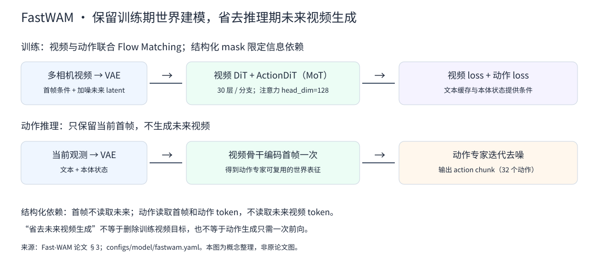
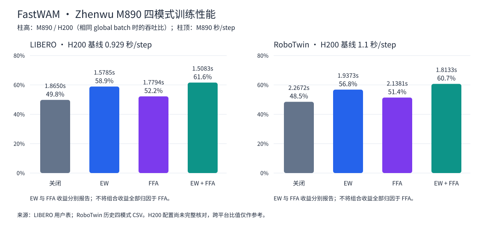
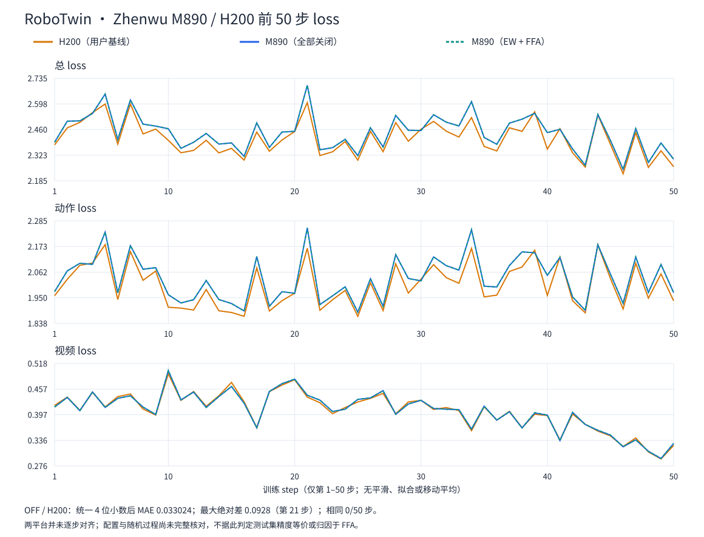

# FastWAM：Zhenwu M890 上的 LIBERO / RoboTwin 训练最佳实践

本文提供两个数据集的环境准备、资产准备、八卡训练入口、优化开关与结果口径。图表和 CSV 随本目录发布，不依赖个人工作区。本文只覆盖 M890，不包含其他设备平台的结果；不将短训练 loss 或内置 evaluate 结果当作仿真任务成功率。

## 1. 模型原理与复现基线

FastWAM 是 [Fast-WAM: Do World Action Models Need Test-time Future Imagination?](https://arxiv.org/abs/2603.16666) 的官方实现。核心思想是：训练时保留未来视频建模以学习世界表征，动作推理时不显式生成未来视频。它使用 Wan2.2-TI2V-5B 的视频 DiT、冻结 VAE 和文本编码器，并加入 ActionDiT，通过 Mixture-of-Transformer（MoT）的结构化注意力共享允许的信息。



当前配置的视频专家 hidden dimension 为 3072，动作专家为 1024；两分支均为 30 层、24 个注意力头、`head_dim=128`。动作 Q/K/V 也投影到 `24 × 128`，不能用 `1024 / 24` 推算 head dimension。mask 保证首帧不读取未来，动作读取首帧和动作 token、不读取未来视频。推理可编码首帧一次并复用视频 K/V，但动作仍需迭代去噪，并非整个模型只做一次前向。

训练对动作和未来视频 latent 使用联合 Flow Matching：

```text
y_t = (1 - σ) · y + σ · ε
目标 velocity = ε - y
loss = λ_video · loss_video + λ_action · loss_action
```

两分支有各自的噪声调度器，当前两个 loss 权重均为 1。本实践是标准 FastWAM（`uncond` 任务），不是 Joint、IDM 或 Optional IDM 变体。`uncond` 不表示没有语言或本体状态条件。

| 项目 | 基线 |
| :--- | :--- |
| 官方源码 | <https://github.com/yuantianyuan01/FastWAM> |
| 本文推荐源码提交 | `f2b055e815a4c3613b38b758f44b37f1475ef038` |
| 训练设备 | 单机 8 张 Zhenwu M890 |
| 并行方式 | Accelerate + DeepSpeed ZeRO-1，DP=8 |
| 精度 / batch | BF16；每卡 16，梯度累积 1，global batch=128 |
| 数据加载 | 每 rank 8 个 worker；CPU TorchCodec |
| 文本条件 | 预计算 T5 embedding；训练不加载在线 T5 |

MoT 的“专家”是模型内的两个 Transformer 分支，不是分布式 EP；本文不使用 TP、PP 或 CP。官方 RoboTwin 完整训练使用更多卡，本文八卡场景用于本平台训练与性能验证，不代表复现了官方完整训练规模或最终成功率。

## 2. 准备环境

以下基础镜像是已使用的环境起点，不是固化本文全部优化的 FastWAM 专用镜像：

```text
pkg.flytiger-eco.com/docker_release/llm:sdk2.2.0-pytorch2.13.0-ubuntu24.04-cuda13.0-vllm0.27.0-py312-20261001
```

| 环境项 | 配置 / 要求 |
| :--- | :--- |
| Python / SDK | Python 3.12；SAIL SDK 2.2.0 兼容环境 |
| 后续千步与 SDPA 验证 wheel | PyTorch `2.13.0`，`torch.version.git_version=9a1cf3bee85a2c725e1e736594b524ebfcca6ba0` |
| torchvision / triton | 保留基础环境中兼容的 PPU 构建，不替换为 NVIDIA wheel |
| DeepSpeed / Accelerate | PPU 可用的 DeepSpeed 0.18.7；Accelerate 1.12.0 |
| 视频解码 | CPU TorchCodec `0.17.0+cpu`，以及支持数据视频编码的 FFmpeg 动态库 |
| 其他依赖 | 以该提交的 `pyproject.toml` 固定版本为准，排除其 NVIDIA torch/vision/codec 要求 |

旧基础镜像中的 torch 不等于上述后续验证 wheel；仅拉取同名镜像或仅确认 `2.13.0` 版本号，不足以证明拥有 FFA 支持。需要准备匹配 SDK/Python 的 PPU wheel 并核对 git version。历史四模式表来自已有结果，不宣称本轮用该 wheel 重新测量了四模式。

若需要新建容器，可在宿主机执行下列命令。已有训练容器可直接继续，不必重建：

```bash
export BASE_IMAGE=pkg.flytiger-eco.com/docker_release/llm:sdk2.2.0-pytorch2.13.0-ubuntu24.04-cuda13.0-vllm0.27.0-py312-20261001
mkdir -p /path/to/fastwam-assets

docker run --privileged --name fastwam_train \
  --network=host --ipc=host --pid=host \
  --ulimit memlock=-1 --ulimit stack=67108864 --init -dit \
  -v /path/to/fastwam-assets:/workspace/fastwam-assets \
  "$BASE_IMAGE" /bin/bash
```

后续命令均在已激活训练环境和 SDK 的容器终端内执行，不使用 `docker exec` 包装。源码与资产路径为示例，建议不含空格。

```bash
export FASTWAM_ROOT=/workspace/FastWAM
export ASSET_ROOT=/workspace/fastwam-assets

git clone https://github.com/yuantianyuan01/FastWAM.git "$FASTWAM_ROOT"
cd "$FASTWAM_ROOT"
git checkout f2b055e815a4c3613b38b758f44b37f1475ef038

# 安装来源由本地交付包指定，不能以 NVIDIA 官方 torch wheel 替代。
: "${PPU_TORCH_WHEEL:?请设置兼容SDK的PPU torch wheel路径}"
: "${PPU_TORCHCODEC_WHEEL:?请设置兼容的CPU TorchCodec 0.17.0+cpu wheel路径}"
python -m pip install --no-deps "$PPU_TORCH_WHEEL"
python -m pip install --no-deps "$PPU_TORCHCODEC_WHEEL"
python -m pip install --no-deps -e .

# 只安装普通应用依赖，保留已有PPU torch、torchvision、triton、DeepSpeed和CPU TorchCodec。
python - <<'PY'
import re
import subprocess
import sys
import tomllib
from pathlib import Path
config = tomllib.loads(Path('pyproject.toml').read_text())
keep = {'torch', 'torchvision', 'triton', 'torchcodec', 'deepspeed'}
deps = [d for d in config['project']['dependencies']
        if re.split(r'[<>=!~\[ ]', d, maxsplit=1)[0].lower() not in keep]
subprocess.check_call([sys.executable, '-m', 'pip', 'install', '--no-deps', *deps])
PY

python - <<'PY'
import torch
import torchvision
import torchcodec
import deepspeed
import accelerate
assert torch.__version__ == '2.13.0', torch.__version__
assert torch.version.git_version == '9a1cf3bee85a2c725e1e736594b524ebfcca6ba0'
assert torchcodec.__version__ == '0.17.0+cpu', torchcodec.__version__
assert torch.cuda.is_available()
assert torch.cuda.device_count() == 8
print(torch.__version__, torch.version.git_version)
print('torchcodec:', torchcodec.__version__)
PY
```

普通依赖示例使用 `--no-deps` 防止传递依赖替换 PPU 包；新环境若缺少传递依赖，需要按缺项补齐，不能将该命令视为完整环境锁文件。CPU TorchCodec 需预先安装兼容 wheel，并对实际视频执行解码验证。仅有 PyAV 或成功导入 torch 不能证明 AV1 视频可读取。上游包元数据仍固定 NVIDIA 依赖，因此不能宣称整个环境 `pip check` 无冲突；不要为了消除声明冲突更换 PPU wheel。

## 3. 准备模型、数据、文本缓存和归一化统计

### 3.1. 模型权重

```bash
mkdir -p "$ASSET_ROOT/models" "$ASSET_ROOT/checkpoints" "$ASSET_ROOT/configs"
export DIFFSYNTH_MODEL_BASE_PATH="$ASSET_ROOT/models"

huggingface-cli download Wan-AI/Wan2.2-TI2V-5B \
  --local-dir "$ASSET_ROOT/models/Wan2.2-TI2V-5B"
```

下载目录需含 `diffusion_pytorch_model*.safetensors`、`Wan2.2_VAE.pth`、`models_t5_umt5-xxl-enc-bf16.pth` 和 `google/umt5-xxl/` tokenizer。下文将 `model_id` 和 `tokenizer_model_id` 同设为本地目录名 `Wan2.2-TI2V-5B`，关闭公共文件重定向，避免混用不同来源的 T5/VAE。

已有同版本 ActionDiT 初始化文件可复用；否则按官方预处理逻辑从 Wan DiT 插值生成。先在资产目录生成只调整本地模型路径的预处理配置：

```bash
python - <<'PY'
import os
from omegaconf import OmegaConf
cfg = OmegaConf.load('configs/model/fastwam.yaml')
cfg.model_id = 'Wan2.2-TI2V-5B'
cfg.tokenizer_model_id = 'Wan2.2-TI2V-5B'
cfg.redirect_common_files = False
OmegaConf.save(cfg, os.path.join(os.environ['ASSET_ROOT'], 'configs/fastwam-preprocess.yaml'))
PY
python scripts/preprocess_action_dit_backbone.py \
  --model-config "$ASSET_ROOT/configs/fastwam-preprocess.yaml" \
  --output "$ASSET_ROOT/checkpoints/ActionDiT_linear_interp_Wan22_alphascale_1024hdim.pt" \
  --device cuda --dtype bfloat16
```

该文件是 ActionDiT backbone 初始化，不是已经在机器人数据集上训练完成的策略 checkpoint。冻结 VAE 和缓存文本不意味着冻结视频 DiT；训练更新视频与动作专家。

### 3.2. 两个数据集

LIBERO 使用官方 LeRobot v3.0 数据，不与 v2.1 路径混用：

```bash
huggingface-cli download yuanty/LIBERO-fastwam --repo-type dataset \
  --include 'lerobot_v30/**' --local-dir "$ASSET_ROOT/data/libero"
export LIBERO_DATA="$ASSET_ROOT/data/libero/lerobot_v30"
```

该目录下应有 `libero_spatial_no_noops_lerobot`、`libero_object_no_noops_lerobot`、`libero_goal_no_noops_lerobot`、`libero_10_no_noops_lerobot` 四套数据。每套含 `meta/`、parquet 数据及视频。

RoboTwin 使用官方 LeRobot v2.1 发布数据。已有整理后的数据可直接使用；若下载的是分片压缩包，先按官方方法拼接解压：

```bash
huggingface-cli download yuanty/robotwin2.0-fastwam --repo-type dataset \
  --revision aac262c35d02cc71b2f6ef670bd65fd9f2bb2547 \
  --local-dir "$ASSET_ROOT/data/robotwin-download"
mkdir -p "$ASSET_ROOT/data/robotwin"
cat "$ASSET_ROOT"/data/robotwin-download/robotwin2.0.tar.gz.part-* | \
  tar -xzf - -C "$ASSET_ROOT/data/robotwin"
export ROBOTWIN_DATA="$ASSET_ROOT/data/robotwin/robotwin2.0"
```

拼接命令假设该 revision 的分片齐全且文件名与官方 README 一致；若下载结果已经是解压目录，不重复执行。`ROBOTWIN_DATA` 应直接指向包含 `meta/`、`data/`、`videos/` 的目录，而非外层下载目录。

| 数据配置 | LIBERO | RoboTwin |
| :--- | :--- | :--- |
| task | `libero_uncond_2cam224_1e-4` | `robotwin_uncond_3cam_384_1e-4` |
| data | `libero_2cam_lerobot_v30` | `robotwin` |
| 读取器 | `lerobot3`，v3.0 | `lerobot`，v2.1 |
| 相机 | `image`、`wrist_image` | `cam_high`、`cam_left_wrist`、`cam_right_wrist` |
| 最终拼接视频 `[H,W]` | `[224,448]` | `[384,320]` |
| 动作 / 本体状态维度 | 7 / 8 | 14 / 14 |
| 采样窗口 | 33 个观测位置；32 个动作；每 4 个观测取一帧，共 9 帧 | 相同 |
| epochs / evaluate 周期 | 10 / 200 step | 5 / 500 step |

RoboTwin 不是三张 `[384,320]` 相机图横向拼接：各图先处理到 `[240,320]`，随后顶视图缩放为 `[256,320]`，两张腕部图各为 `[128,160]` 并排放在下方，合成为 `[384,320]`。episode 是一条完整操作轨迹，33 个观测通常是其内部的训练窗口，不是完整 episode。

### 3.3. 配置路径、预计算文本缓存

先定义共用与数据路径覆盖项，供预处理和正式启动复用：

```bash
COMMON_ARGS=(
  model.model_id=Wan2.2-TI2V-5B
  model.tokenizer_model_id=Wan2.2-TI2V-5B
  model.redirect_common_files=false
  model.load_text_encoder=false
  "model.action_dit_pretrained_path=$ASSET_ROOT/checkpoints/ActionDiT_linear_interp_Wan22_alphascale_1024hdim.pt"
)
LIBERO_DIRS="[$LIBERO_DATA/libero_spatial_no_noops_lerobot,$LIBERO_DATA/libero_object_no_noops_lerobot,$LIBERO_DATA/libero_goal_no_noops_lerobot,$LIBERO_DATA/libero_10_no_noops_lerobot]"
LIBERO_ARGS=(
  "data.train.dataset_dirs=$LIBERO_DIRS"
  "data.train.text_embedding_cache_dir=$ASSET_ROOT/text_embeds_cache/libero"
)
ROBOTWIN_ARGS=(
  "data.train.dataset_dirs=[$ROBOTWIN_DATA]"
  "data.val.dataset_dirs=[$ROBOTWIN_DATA]"
  "data.train.text_embedding_cache_dir=$ASSET_ROOT/text_embeds_cache/robotwin"
  "data.val.text_embedding_cache_dir=$ASSET_ROOT/text_embeds_cache/robotwin"
)

python scripts/precompute_text_embeds.py \
  task=libero_uncond_2cam224_1e-4 data=libero_2cam_lerobot_v30 \
  "${COMMON_ARGS[@]}" "${LIBERO_ARGS[@]}"
python scripts/precompute_text_embeds.py \
  task=robotwin_uncond_3cam_384_1e-4 \
  "${COMMON_ARGS[@]}" "${ROBOTWIN_ARGS[@]}"
```

缓存脚本会加载 T5，即使训练配置为 `model.load_text_encoder=false`；该开关用于训练组装，不关闭缓存预计算。脚本按每套数据的 `meta/tasks.jsonl` 读取文本；已使用的 LIBERO v3 数据同时保留该兼容文件。若新数据仅有 `tasks.parquet`，需先准备同任务、同 prompt 格式的兼容文本元数据，不能以空缓存继续训练。已有匹配缓存可跳过预计算。

归一化统计必须与数据、动作处理和划分一致，不能在两数据集间共享。LIBERO 使用 min/max 和 delta action，RoboTwin 使用 z-score。下列变量既可设已有匹配统计文件，也可在首次初始化时设为字面量 `null`，让数据初始化计算统计并保存到 run 目录：

```bash
export LIBERO_STATS=null
export ROBOTWIN_STATS=null
```

新数据统计计算尤其在 RoboTwin 上可能较慢。正式对照四模式时应复用同一份已生成统计，分别将两变量改为各自的 `dataset_stats.json` 路径；RoboTwin train/val 使用同一份训练统计。

## 4. 八卡训练与优化开关

### 4.1. NUMA 预检

```bash
cd "$FASTWAM_ROOT"
export CUDA_VISIBLE_DEVICES=0,1,2,3,4,5,6,7
bash scripts/train_LIBERO.sh --check
bash scripts/train_RoboTwin.sh --check
```

入口从卡的 PCI NUMA 节点、当前允许的 CPU 集合及 SMT sibling 动态生成绑定计划，不硬编码 CPU 编号。每 rank 使用 8 个物理核代表；另 8 个核分别给 8 个 worker，各 worker 绑定一个核。rank 的 OMP/MKL 线程数为 8，PyTorch worker 的原生线程限制为 1。`sitecustomize` 在 torch/模型/数据创建前设置 CPU affinity 与 `MPOL_BIND`，并在 worker 入口重新绑定。

验证机器有 128 个物理核 / 256 个逻辑 CPU；PPU0–3 位于 NUMA1，PPU4–7 位于 NUMA0。这只是该机器拓扑示例；`ppu-smi topo -m` 是硬件地图，不能证明进程已绑定。预检会核验绑定权限和资源，失败即停止；CPU 不足、非 `fork` worker 或受限容器不能直接照搬。绑核不独占外部负载，内存策略也不迁移已有页或保证所有共享页本地化。

### 4.2. 开关组合

正式入口不设置或清除优化开关，由终端显式控制。关闭时使用 `unset`，不把字符串 `0` 当作未设置。

```bash
# 全部关闭
unset PYTORCH_ENABLE_PPU_ELEMENTWISE_OPT
unset PYTORCH_ENABLE_PPU_FLEX_FLASH_ATTENTION TORCH_FLEX_FLASH_SDPA_ENABLED

# 仅elementwise：在“全部关闭”后执行
export PYTORCH_ENABLE_PPU_ELEMENTWISE_OPT=1

# 仅FFA：在“全部关闭”后执行
export PYTORCH_ENABLE_PPU_FLEX_FLASH_ATTENTION=1
export TORCH_FLEX_FLASH_SDPA_ENABLED=1

# 双开：正式优化配置
export PYTORCH_ENABLE_PPU_ELEMENTWISE_OPT=1
export PYTORCH_ENABLE_PPU_FLEX_FLASH_ATTENTION=1
export TORCH_FLEX_FLASH_SDPA_ENABLED=1
```

四段表示四种独立实验配置，不是同一次对照运行中依次执行所有段。对照时每种模式重新启动同样权重、seed、采样序列、统计和学习率计划。

### 4.3. 正式启动

在设置好上述路径变量、Bash 数组、统计文件和所需开关后执行：

```bash
# LIBERO：默认保留10 epoch、scheduler和evaluate，每2000步保存。
bash scripts/train_LIBERO.sh \
  "${COMMON_ARGS[@]}" "${LIBERO_ARGS[@]}" \
  "+data.train.pretrained_norm_stats=$LIBERO_STATS" \
  wandb.enabled=false profiler.enabled=false

# RoboTwin：默认保留5 epoch、scheduler和evaluate；入口默认不保存checkpoint。
# 完整训练应显式恢复保存周期，并预留输出空间。
bash scripts/train_RoboTwin.sh \
  "${COMMON_ARGS[@]}" "${ROBOTWIN_ARGS[@]}" \
  "data.train.pretrained_norm_stats=$ROBOTWIN_STATS" \
  "data.val.pretrained_norm_stats=$ROBOTWIN_STATS" \
  save_every=2500 wandb.enabled=false profiler.enabled=false
```

两个入口最终委托 `train_zero1.sh`，不另写简化训练循环；固定 `num_workers=8` 并覆盖视频后端为 TorchCodec。任务配置中 `model.compile_training_denoise=false`；VAE 另有 batched encoding / CUDA Graph 路径，不能把两者混为一个开关。不得为了百步/千步测量随意改 `max_steps`，因为它可能改变 scheduler 总步数和前 50 步学习率。短训应使用保留原 schedule 的停止方式，并记录该方式；本文不提供未验证的停止回调。

## 5. 优化方法

| 优化 | 方法与边界 |
| :--- | :--- |
| 图像选帧前移 | 仍解码原请求的 33 帧，先选模型原本需要的 9 帧，再转换/resize；不是把解码数量降为 9。只有已知逐帧、无随机性的原生变换才启用 |
| HF 查询与格式化 | 相同相机索引复用 timestamp 查询，只转换所需列；字段仅在完整索引序列一致时合并查询，不能把 32 行 action 与 33 行 state 强行合并 |
| RoboTwin 冷元数据 | 标准 v2.1 读取器将 episodes/episodes_stats 对象树保存为 bytes，按需恢复；减少 fork 后 GC 扫描与 COW，不是视频压缩，不代表字节数同比缩小 |
| NUMA + 线程数 | 将 rank、worker 和适用后续内存分配放到卡本地 NUMA，限制线程争抢；LIBERO v3 复用绑定工具但不依赖 v2 冷元数据补丁 |
| elementwise | 加速符合准入条件的非连续、广播和 backward elementwise；不改采样、模型或训练目标 |
| FFA | 在 `F.scaled_dot_product_attention` 后端替换符合条件的执行路径，保留 mask 语义；浮点计算顺序变化需做 loss 与长期任务精度验证 |

函数名 `flash_attention` 不代表 FFA 已命中。应从短诊断 trace/dispatch 记录确认 `aten._scaled_dot_product_flex_flash_attention`，然后关闭 Profiler 做性能计时。后续千步两场景已观察到该后端命中；并非所有 SDPA 都应走 FFA，VAE 的 head dimension 640/1024 超出已验证 FFA 上限 256，预期回退。不要把旧 wheel 的 CUTLASS trace 当作当前 wheel 的后端状态。

## 6. 性能与 loss



M890 表中吞吐按 global batch=128 计算。H200 基线由用户提供：LIBERO 为 `0.929 s/step`（`num_workers=4`），RoboTwin 为 `1.1 s/step`；两者不能混用。H200 卡数、global batch、dtype、计时窗口尚未完整核对，以下跨平台列首先是耗时比，仅在 global batch 一致时等于 M890/H200 吞吐比，不是硬件峰值比或任务成功率。

```text
samples/s = global_batch / mean_seconds_per_step
吞吐提升 = (关闭耗时 / 当前耗时 - 1) × 100%
M890/H200 = H200耗时 / M890耗时（相同global batch时等于吞吐比）
```

### 6.1. LIBERO

FastWAM 已按官方推荐流程跑通 LIBERO。按用户提供基线，M890 关闭 PPU 算子优化时约为 H200 的 50%（49.8%），elementwise + FFA 双开后提升至 61.6%。这里的“开箱”指该表中的关闭算子优化配置，不包含 CPU 调优前后差值的独立消融。

| 优化配置 | M890 秒/step | 吞吐 samples/s | 相对关闭的吞吐提升 | M890/H200 |
| :--- | ---: | ---: | ---: | ---: |
| 全部关闭 | 1.8650 | 68.63 | — | 0.498× |
| 仅 elementwise | 1.5785 | 81.09 | +18.15% | 0.589× |
| 仅 FFA | 1.7794 | 71.93 | +4.80% | 0.522× |
| elementwise + FFA | 1.5083 | 84.86 | +23.55% | 0.616× |

该表保留用户原图数值；按显示耗时重算，FFA 和双开的提升分别为 **4.81% / 23.65%**，与原表略有出入，不将其隐藏或当作新测量。原表统计窗口未在现有摘录中完整记录，不套用 RoboTwin 的 21–100 步窗口。

用户提供的百步观察为：elementwise 不带来 loss 变化；FFA 在 100 step 产生约 0.3% 的 loss 值变化。0.3% 的具体统计定义尚未核对，不解释为最大相对误差或测试集精度下降。仍需更长训练并在仿真测试集比较任务成功率。没有 LIBERO 的 H200 逐步 loss，故不构造其跨平台 loss 图。

### 6.2. RoboTwin

该轮四模式采用同一组数据读取优化，单机八卡、BF16、ZeRO-1、每卡 batch=16。每模式 100 步；性能统计第 21–100 步全部 80 步，不剔除慢步。收益是在共同 CPU 数据路径上切换 PPU 算子开关的结果，不是原始 CPU 路径与优化路径的总收益。

| 优化配置 | M890 秒/step | 吞吐 samples/s | 相对关闭的吞吐提升 | M890/H200 |
| :--- | ---: | ---: | ---: | ---: |
| 全部关闭 | 2.2672 | 56.46 | — | 0.485× |
| 仅 elementwise | 1.9373 | 66.07 | +17.03% | 0.568× |
| 仅 FFA | 2.1381 | 59.87 | +6.04% | 0.514× |
| elementwise + FFA | 1.8133 | 70.59 | +25.03% | 0.607× |



图只使用第 1–50 步，无平滑、拟合或移动平均。M890 OFF 与 BOTH 来自该轮百步记录；H200 为用户四位小数摘录。M890 OFF 与 H200 总 loss 统一四位小数后相同 **0/50** 步，平均绝对差 **0.033024**，最大绝对差 **0.0928**（第 21 步）。两平台尚未逐步对齐，不能从图形趋势判定训练或测试集精度等价。

差异在 OFF 中已存在，不能直接归因于 FFA 或 elementwise；原因需核对双方权重、配置、seed 与播种时机、样本顺序、归一化、学习率以及 noise/timestep 等随机过程。M890 该轮 EW 与 OFF 的 100 步三项 loss 记录精确相同；FFA/BOTH 对 OFF 总 loss 的百步最大绝对差约为 `0.00118017 / 0.000876427`，这是另一种误差口径，不与 LIBERO 的 0.3% 混为一谈。

### 6.3. 独立千步稳定性验证

后续两套正式八卡入口在双开条件下分别完成 1000 次更新和原周期 evaluate。该轮记录独立于上面的百步性能消融，不以其双开均值替换百步表。

| 数据集 | 更新数 | 统计区间 | 平均秒/step | 耗时 CV | 区间最大秒/step | evaluate 完成步数 |
| :--- | ---: | :--- | ---: | ---: | ---: | :--- |
| LIBERO | 1000 | 21–1000 | 1.4929 | 1.36% | 1.7290 | 200 / 400 / 600 / 800 / 1000 |
| RoboTwin | 1000 | 21–1000 | 1.8021 | 0.72% | 2.0938 | 500 / 1000 |

CV 为单步耗时标准差除以平均值，不是 loss 波动或精度误差。该结果说明此配置完成千步更新与内置 evaluate，不能证明完整训练收敛或 M890/H200 仿真成功率一致。

## 7. 图表、数据与验收

- [性能 CSV](./assets/performance.csv)：LIBERO 保留用户显示精度；RoboTwin 保留原 CSV 精度。
- [RoboTwin M890 前50步](./assets/robotwin-m890-first-50.csv)：四模式各 50 步，保留 loss 分项与 lr；图显示 OFF/BOTH。
- [RoboTwin H200 前50步](./assets/robotwin-h200-first-50.csv)：保留用户独立记录的总/分项四位数，不重算总 loss。
- [千步稳定性 CSV](./assets/stability.csv)与[来源和限制](./assets/sources.json)。
- [图表生成与核验工具](./render_figures.py)：正式文档工具，仅依赖 Python 标准库，输出 SVG。

```bash
# 在sail-train-recipes根目录，重新生成本目录图表。
python best_practice/fastwam/render_figures.py

# 只读核验已发布图表、数据算术、文档表格、相对链接与命令语法，不执行训练。
python best_practice/fastwam/render_figures.py --check \
  --documents best_practice/fastwam/README.md

# 可选：将同一组正式资源同步到best_practice_doc；两个仓库路径由本地指定。
python best_practice/fastwam/render_figures.py \
  --publish-dir /path/to/best_practice_doc/docs/training-finetuning/pictures/fastwam
```

工具的 `--source-artifacts` 可在保有历史日志的环境中进一步核对原 CSV / 千步报告，默认不依赖这些外部文件。`--documents` 只检查 Bash/Python 语法和 Markdown 资源，不执行下载、安装或训练；文档命令本轮未重跑，不能将语法检查称为新容器端到端验证。

验收需分层：数据/采样语义不变；SDPA forward/backward 与准入/回退正确；稳定 step 性能统计；长训练收敛；最终仿真任务成功率。已有独立 FastWAM SDPA 单测为 77 项通过，相关回归 15 项通过，属于算子和调用覆盖证据，不是任务精度验收。完整精度对照仍需使用对应 checkpoint、归一化统计、相同仿真环境与评测协议执行官方 `experiments/libero/run_libero_manager.py` / `experiments/robotwin/run_robotwin_manager.py`。

算法参考采用官方论文 §3 与上述源码。补充钉钉链接见[来源记录](./assets/sources.json)；当前链接要求登录，未读取其正文，本文不据此添加未核实的结论。
